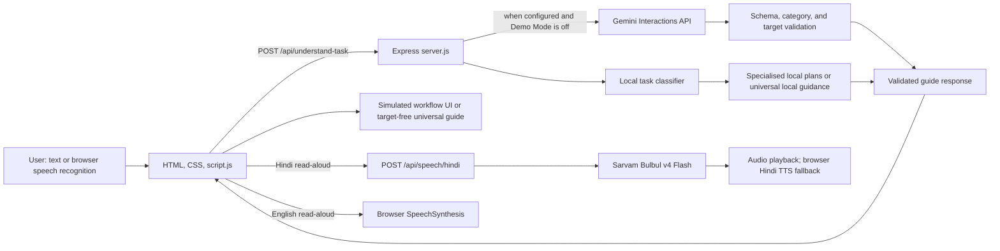
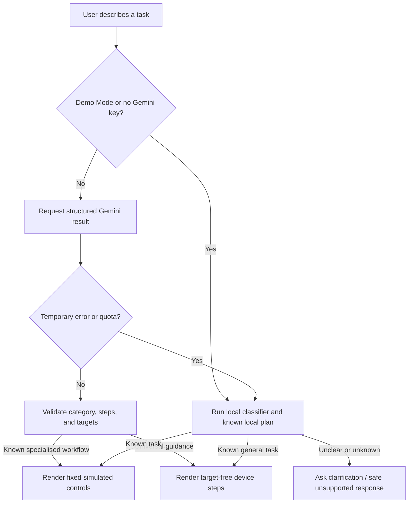

# Raasta — Project Documentation

## 1. Project overview and problem statement

Raasta is a bilingual digital task guide. A user describes a task in ordinary English, Hindi, or Romanized Hinglish; Raasta classifies the request and presents either a simulated, highlighted workflow or practical general guidance. It is intended to help people who know what they want to do but need support finding the next step in an unfamiliar digital interface.

The project demonstrates guided interaction rather than acting on real services. Its student-portal, train, document, and phone screens are simulations. Universal Guidance gives text instructions for a real device but cannot see or control that device.

## 2. Vision, objectives, and target users

**Vision:** make common digital tasks easier to approach by combining everyday-language requests with patient, accessible, visual and spoken guidance.

Project objectives are to:

- understand supported requests in English, Devanagari Hindi, and Romanized Hinglish;
- explain a task one step at a time, with controls highlighted in the specialised simulations;
- provide a deterministic local demo path that does not call Gemini;
- make general digital guidance available where a safe local guide exists, and ask for clarification where details matter;
- preserve user control: users navigate, repeat, ask for help, or restart the guide themselves.

Raasta is designed for first-time or less confident technology users, Hindi and Hinglish speakers, and people who benefit from visual structure, slower instructions, larger text, contrast options, or read-aloud. These are design goals; they do not imply that the application has passed a formal accessibility audit.

## 3. Technology stack and system architecture

The frontend is plain HTML, CSS, and browser JavaScript. The backend is Node.js with Express. Gemini task understanding uses Google's `@google/genai` SDK; Hindi speech uses a server-side request to Sarvam AI. There is no frontend framework or database.



The main path is: collect a task, select a language, understand the task, validate the result, then render the matching guide or a useful clarification. The backend supplies local plans when there is no Gemini key, when Demo Mode is requested, or after eligible temporary Gemini failures.

## 4. Frontend and backend architecture

### Frontend

`index.html` provides the page structure and controls. `style.css` defines the current visual design, responsive layouts, theme palettes, high-contrast styles, focus states, and workflow components. `script.js` manages language and preferences, speech input/output, API requests, validation of returned guide shape, context-aware assistance, and the workflow renderers.

The frontend uses one active-guidance interface for Previous, Next, Restart, current-step help, and refresh after a guidance-mode change. The specialised workflows and Universal Guidance have distinct content, but share the step navigation, progress, read-aloud, and feedback patterns. Specialised simulations highlight only their fixed in-app controls. Universal steps are explicitly target-free.

### Backend

`server.js` creates the Express app and defines:

| Route | Purpose |
| --- | --- |
| `GET /api/health` | Reports whether task understanding is in AI or local/demo mode. |
| `POST /api/understand-task` | Validates task and language, applies Demo Mode/local classification, or calls Gemini and validates the result. |
| `POST /api/speech/hindi` | Validates Hindi speech text and returns Sarvam-generated audio when configured. |
| `GET /`, `/index.html`, `/script.js`, `/style.css` | Serves the frontend files. |

The server limits JSON request size, validates task length and output shape, and keeps API keys on the server. Gemini operations have a 15-second overall deadline. The SDK's automatic retry is disabled; the application controls a single retry for eligible transient errors within that deadline. Quota-exhaustion errors are not retried. Timing logs separate Gemini duration from total request duration.

## 5. Gemini integration and local intent classification

When Demo Mode is off and `GEMINI_API_KEY` is configured, the server sends one structured task-understanding request through the Google GenAI Interactions API. The prompt asks Gemini to preserve the specialised categories, support English/Hindi/Hinglish, produce concise steps, request clarification when device information is necessary, and avoid claiming real-world actions. Generation requests JSON output; the backend validates the category, step shape, and exact allowlisted target sequence before returning a specialised plan. Universal plans must not contain target IDs.

The selected model is configurable through `GEMINI_MODEL`; the current source default and `.env.example` value are `gemini-3.8-flash`. Model availability and quota depend on the Google account and current service offering. The project history includes a real HTTP 429 free-tier quota response for the configured model, so this documentation does not claim that live Gemini is currently available.

`task-intent.js` provides deterministic local classification for known workflows, including college fee receipts, train journeys, sample student documents, and the phone tutorial topics. It distinguishes student fee receipts from unrelated receipts and includes contextual speech-transcript correction for likely “free receipt” transcription errors. It does not replace every Gemini capability: unknown or ambiguous requests may result in clarification.

The local fallback also includes known Universal Guidance plans. On temporary service errors, quota exhaustion, or an overall timeout, the backend uses a safe local plan where one is available; unknown tasks receive a clarification or controlled unsupported response. Permanent configuration errors, such as invalid credentials, are reported rather than silently represented as successful AI results.

## 6. Sarvam Hindi TTS and English browser TTS

For Hindi Read Aloud, the browser sends the instruction text to `POST /api/speech/hindi`. The backend reads `SARVAM_API_KEY` from the environment and requests Sarvam Bulbul v4 Flash (`bulbul:v4-flash`) with Hindi language code `hi-IN` and the `aparna_hi_customer` persona. The response is returned as playable MP3 audio. Text is validated and capped at 2,500 characters; the upstream request has a timeout and safe user-facing error responses.

If Sarvam is not configured or the request/playback fails, the frontend attempts browser Hindi SpeechSynthesis. English Read Aloud continues to use browser SpeechSynthesis and does not call Sarvam. Speech requests are cancelled on step changes and when new speech starts; the frontend avoids overlapping playback and releases temporary audio resources.

Voice quality and voice availability depend on the Sarvam service or the browser's installed voices. No physical-speaker quality test is represented by the automated test results.

## 7. Speech recognition and multilingual support

The microphone control uses the browser's `SpeechRecognition` or `webkitSpeechRecognition` implementation when available. It selects `en-IN` for English or `hi-IN` for Hindi. Recognition fills the task field and shows the transcript for review; the user still submits the request. Permission-denied, no-speech, unavailable-service, and unsupported-browser cases have user-facing feedback. Text input remains available when recognition cannot be used.

The interface selector offers English and Hindi. Romanized Hinglish is an input style, not a separate interface-language choice. Local intent rules and the Gemini prompt support Devanagari Hindi and Romanized Hinglish. Browser recognition support, quality, permission behavior, and whether audio is processed remotely depend on the browser and its speech service.

## 8. Four specialised workflows

These journeys use simulated interfaces and fixed target IDs. Completion screens disclose that no real-world transaction or setting change occurred.

### College fee receipt

The simulated student portal guides the user through Documents, Fee Receipts, and Download Receipt. The allowlisted target IDs are `portalDocuments`, `portalReceipts`, and `portalDownload`. Supported intents include college, hostel, tuition, semester, or academic fee receipts. Train, shopping, utility, and bank receipts are not treated as student fee receipts.

Example: “Hostel fees bhar di, receipt kahan milegi?”

### Train booking

The simulation covers entering source and destination, choosing a date, searching sample trains, selecting a train, entering demo passenger details, reviewing, and reaching a simulated completion screen. It does not query live train schedules, reserve a seat, collect payment, or issue a ticket.

Example: “I want to book a train from Jaipur to Delhi.”

### Document download

The simulated journey opens Documents, chooses a category and sample document, shows a preview, and presents a simulated download-complete state. Current examples include bonafide certificates, marksheets, ID cards, and fee receipts. No real institutional record is retrieved.

Example: “I want to download my bonafide certificate.”

### Smartphone basics

The in-app phone simulator provides tutorials for Wi-Fi connection, brightness adjustment, and Bluetooth on/off. A general phone request can open a topic chooser. These controls update only the simulation, not the user's device.

Example: “Mujhe Bluetooth on karna hai.”

## 9. Universal Guidance Mode and local fallback

Universal Guidance handles safe, everyday digital tasks beyond the four specialised simulations where the local guide has a known plan or Gemini can provide validated text steps. Local examples include turning a TV on or off, changing its HDMI input, connecting a phone or laptop to a TV, turning on a PS5, pairing a PS5 controller, connecting Bluetooth headphones to a laptop, taking a Windows screenshot, turning on a phone hotspot, installing an application, or creating a Gmail account.

Local plans are deterministic for the task families implemented in `universal-guidance.js`. A local plan has two to eight named steps and is target-free: Raasta does not claim to see the user's screen or highlight a real device control. The guidance acknowledges platform/model variation, adds caution for security or privacy-sensitive changes, and does not request passwords or verification codes. Destructive requests such as factory reset are not treated as ordinary tutorials; they receive caution and a clarification. Requests needing device information, such as location controls without a specified platform, ask a short question.

If a safe local guide is unavailable, Raasta asks for clarification or gives a controlled unsupported response. Gemini-generated Universal Guidance is also validated and may not invent target IDs.



## 10. Demo Mode and Reset Demo

Demo Mode can be enabled with the homepage checkbox. It sends an explicit `demoMode` flag to the backend, uses the local classifier and current local plans, and skips the Gemini request. The page displays a status that Demo Mode is active. It is intended for repeatable demonstrations and can be used even when Gemini quota is exhausted.

Homepage examples fill the existing task field; the presenter then chooses **Guide me**. **Reset demo** clears the current guide, request, highlight/progress state, pending request, microphone listening, and speech playback, returning to the task entry. It preserves session accessibility and guidance-mode settings, language, and Demo Mode preference. Reset affects the simulation only.

Demo Mode means local task understanding; it is not a promise that the whole application is disconnected from the network. Hindi Sarvam TTS may contact Sarvam, and browser speech recognition may rely on browser-provided services.

## 11. Context-aware assistance and guidance modes

While following a guide, users can ask for simpler wording, repeat the instruction, ask where to click, or say they are stuck. Raasta derives help from the current workflow and step. For highlighted simulated controls it points to that control; for Universal Guidance it explains that it cannot see the real screen and repeats the current practical step. Assistance does not advance or restart the guide unless the user requests navigation.

Natural-language Previous, Next, Repeat, and Restart commands reuse the active guide's navigation functions. A clearly phrased new digital task is submitted automatically without a `new task:` prefix. An ambiguous device mention asks one clarification. If a new task is unsupported, Raasta shows its clarification while preserving the current guide and step; unrelated questions also leave progress unchanged.

**Beginner** is the default and adds more explanation, plain language, and direction about where to look. **Experienced** uses shorter guidance. The selection is kept for the current browser session and updates the active guide without resetting its step.

## 12. Accessibility features

The interface includes Normal, Large, and Extra large text controls; high-contrast mode; read-aloud speed selection; English/Hindi read-aloud; repeat instruction; Beginner/Experienced guidance; keyboard-operable native buttons and selects; visible focus styling; labelled controls; pressed/checked state labels; and live status, step, and progress announcements. The microphone state is exposed through button text and ARIA state. Responsive CSS adapts the interface for narrower screens.

These are implemented aids, not a certification. A formal screen-reader, keyboard-only, contrast measurement, and assistive-technology audit has not been established here. Actual mobile rendering and microphone behavior also require browser testing.

## 13. Dark/light theme system

The current frontend source includes a dark theme and a light theme, a labelled theme toggle, coordinated CSS variables, and a first-visit theme choice that can follow the system preference. The selected theme is stored in local storage; accessibility and guidance preferences are stored for the browser session. High contrast is a separate mode.

The theme implementation and related frontend behavior have automated regression coverage. The latest environment could not open the local app in a browser, so the documentation does not claim that every screen has been visually verified in both themes or at every viewport size.

## 14. Security and responsible AI

- `GEMINI_API_KEY` and `SARVAM_API_KEY` are read by the server. Keys do not belong in HTML, frontend JavaScript, documentation, or logs.
- `.env` is listed in `.gitignore`. Use `.env.example` for variable names and non-secret setup guidance only.
- Gemini output is structured and validated. Specialised controls must match the exact allowlist and workflow sequence; Universal Guidance cannot carry target IDs.
- User task text is treated as untrusted input. Instructions reject unsafe/bypass requests and apply extra caution to destructive, payment, account-security, and privacy-sensitive tasks.
- The simulated workflows never claim to have booked, paid, downloaded a real document, or changed a real device setting.
- Avoid entering real student records, passwords, payment information, or verification codes. When AI or speech services are used, task text or spoken instruction text is sent to the respective service. Browser voice recognition data handling depends on the browser provider.
- The local classifier and generated advice can still misunderstand a request. Users should check device-specific and official instructions before performing real actions.

## 15. Testing methodology and latest verified results

The automated test suite uses Node's built-in test runner (`node --test`). Backend tests exercise Express routes with mocked Gemini and Sarvam responses, including valid/invalid requests, allowlist validation, quota behavior, retry/deadline handling, fallback, timeout, malformed responses, and configuration errors. Frontend-flow tests use a simulated DOM/browser harness to test workflow rendering and interaction, navigation, contextual assistance, language and accessibility preferences, Demo Mode, and mocked speech behavior. Intent tests cover English, Hindi, Hinglish, receipt boundaries, and Universal Guidance examples and clarifications.

**Latest executed suite:** `npm test` — **205 tests total: 204 passed, 0 failed, 1 skipped.** The skipped case is an optional live Gemini request; no live Gemini request was made for this verification. Sarvam API behavior is tested with mocks, not real credits. Automated frontend tests are not equivalent to manually operating a browser, microphone, speaker, or physical device.

The companion audit also ran JavaScript syntax checks and `git diff --check` successfully. A local browser attempt timed out, so no successful live browser pass is claimed. Re-run tests after changing the project:

```powershell
npm test
```

## 16. Setup and installation

Requirements: Node.js and npm. Open a terminal in the repository root and run:

```sh
npm install
npm start
```

Then open [http://localhost:3000](http://localhost:3000). The server reads the environment configuration during normal startup. Keep the terminal open while using the app. Run the automated suite with `npm test`.

## 17. Environment configuration

Copy `.env.example` to `.env` locally, then add credentials privately if using external services. Never paste secret values into source code or documentation.

| Variable | Purpose |
| --- | --- |
| `GEMINI_API_KEY` | Optional server-side key for AI task understanding. Leave unset to use local task understanding. |
| `GEMINI_MODEL` | Gemini model name; current example/default is `gemini-3.8-flash`. |
| `SARVAM_API_KEY` | Optional server-side key for Sarvam Hindi speech. Browser Hindi TTS is the fallback. |
| `PORT` | HTTP port; the current example is `3000`. |

`.env` is ignored by Git. Do not print, commit, share, or include its contents in bug reports. When presenting without Gemini, enable Demo Mode. If credentials are not configured, the backend also starts in local/demo task-understanding mode.

## 18. Project structure

| File | Responsibility |
| --- | --- |
| `index.html` | Page structure, homepage task input, examples, language/theme/accessibility controls, Demo Mode. |
| `style.css` | Visual design, responsive behavior, themes, high contrast, focus and workflow styles. |
| `script.js` | Frontend state, API calls, speech, accessibility preferences, context help, specialised workflow renderers, universal guide, reset. |
| `server.js` | Express routes, Gemini/Sarvam integrations, validation, allowlists, deadlines/retry, fallback and logging. |
| `task-intent.js` | Local specialised workflow classification, receipt intent boundaries, language and transcript correction helpers. |
| `universal-guidance.js` | Universal request normalization, safe local guides, device/platform detection, clarification, and safety handling. |
| `server.test.js` | Backend route, mocked integration, validation, retry, fallback, deadline, and security regression tests. |
| `task-intent.test.js` | Local task classification and multilingual regression tests. |
| `universal-guidance.test.js` | General guide content, language, safety, and clarification tests. |
| `frontend-flow.test.js` | Frontend interaction, navigation, accessibility, themes, voice mocks, and workflow regressions. |
| `DEMO_GUIDE.md` | Presenter instructions, three-minute script, troubleshooting, and judge Q&A. |
| `.env.example` | Secret-free environment variable template. |
| `.gitignore` | Excludes `.env`, dependencies, and npm debug logs. |
| `package.json` / `package-lock.json` | Node scripts and locked dependencies. |

## 19. Current limitations

- All four specialised workflow families are simulations; they do not connect to a real college, railway operator, document store, or phone settings service.
- Universal Guidance is not remote device control. It does not inspect the user's screen, verify that a step succeeded, or highlight actual controls.
- The local Universal Guidance fallback covers known tasks, not every digital task. Missing or ambiguous platform details may trigger a question; unknown tasks may not have a guide.
- Gemini availability, model access, quotas, and latency depend on the account and provider. The safe local path is available for known supported tasks, but it cannot reproduce arbitrary model knowledge.
- Hindi voice generation requires Sarvam configuration and service availability; browser fallback depends on browser voice availability. English voice depends on browser SpeechSynthesis.
- Voice recognition depends on browser implementation, permission, device microphone, and potentially the browser's external recognition service. Text entry is the alternative.
- English and Hindi are the interface languages; Hinglish is supported as request input, but a dedicated Hinglish UI mode is not implemented.
- No complete live browser, microphone, speaker, physical-device, or formal accessibility conformance audit is claimed by the latest automated verification.

## 20. Future scope

These are possible next steps, not implemented capabilities:

- conduct usability sessions with beginners and multilingual users, then improve guides from observed friction;
- manually verify responsive behavior, keyboard-only use, screen readers, microphone permissions, and audio on supported browsers/devices;
- expand local deterministic plans for high-value everyday tasks while keeping safety and clarification boundaries;
- if partnering with institutions or service providers, design explicit consent, authentication, privacy, and confirmation flows before any real transaction;
- add operational monitoring and evaluation that does not log secrets or unnecessary personal task data;
- review model availability, quota behavior, and latency periodically against the provider's current service.

## 21. Hackathon demonstration guide

Use the existing [`DEMO_GUIDE.md`](DEMO_GUIDE.md) for the detailed presenter script, setup, reset steps, service fallback advice, and likely judge questions. Its recommended sequence is:

1. Start the app and enable **Demo Mode**; confirm its local-only status.
2. Demonstrate a Hindi/Hinglish fee receipt guide and contextual help.
3. Reset, switch to English, and demonstrate the simulated train booking.
4. Reset, switch to Hindi, and demonstrate the Bluetooth phone tutorial.
5. Point out the simulation disclosures and, if time permits, Beginner/Experienced or an accessibility setting.

Keep Demo Mode active for deterministic task classification. Use sample values only. The presenter should state that no real receipt was downloaded, ticket booked, payment made, or device setting changed. The separate guide was preserved during this documentation update.

## 22. Development journey: challenges and solutions

The following records the key engineering challenges described by the project history and reflected in the current implementation. It distinguishes observed problems from claims about external services.

### 22.1 Gemini free-tier quota exhaustion and HTTP 429

1. **What happened:** Live task-understanding requests returned HTTP 429 with a free-tier daily quota message. Earlier testing also exposed long waits during upstream errors.
2. **Why it mattered:** A demo that waits on an unavailable service or repeatedly retries an exhausted quota can appear frozen and disrupt the user journey.
3. **How we investigated:** Backend logs were reviewed for retry count, HTTP status, Gemini duration, and total route duration. The request deadline and SDK retry configuration were checked rather than assuming the timeout was enforced.
4. **Solution:** The application disables SDK-managed retries, enforces an overall 15-second operation deadline, permits at most one controlled retry for eligible transient failures, and avoids retrying clear quota exhaustion. Known supported requests use local fallback; unsupported requests keep clarification behavior. Demo Mode bypasses Gemini.
5. **What we learned:** Quota errors need separate handling from transient server errors. A bounded wait and deterministic demo path are essential for a reliable presentation. No latency improvement is claimed without measurements.

### 22.2 Building local fallback and Demo Mode

1. **What happened:** AI access could be slow, unavailable, or out of quota, and the demo still needed to run predictably.
2. **Why it mattered:** A working guide should not depend on a live model for every supported task.
3. **How we investigated:** Existing task rules and workflow plans were reused and tested through the same backend endpoint used by the frontend.
4. **Solution:** Local classification and local plans handle known supported tasks when no API key is present, after eligible temporary failures, or when the user explicitly enables Demo Mode. The UI identifies Demo Mode and Reset Demo clears transient guide state while retaining preferences.
5. **What we learned:** Offline-first behavior is more reliable when it reuses the actual workflows rather than maintaining a second demo-only UI. Demo Mode does not imply every service is offline; Sarvam and browser speech may still require services.

### 22.3 Robotic browser Hindi speech and Sarvam Bulbul

1. **What happened:** Browser-generated Hindi speech sounded unnatural in testing.
2. **Why it mattered:** Read-aloud is important to users who prefer spoken instructions, so speech quality affects usability.
3. **How we investigated:** The existing English and Hindi SpeechSynthesis route was inspected and a server-side speech provider was chosen for Hindi.
4. **Solution:** Hindi Read Aloud requests Sarvam Bulbul v4 Flash from the backend, while English retains browser speech. Hindi falls back to browser TTS if Sarvam is missing or fails. Playback is cancelled/replaced on navigation and temporary audio is cleaned up. API behavior is mocked in tests.
5. **What we learned:** Keep credentials server-side, preserve a browser fallback, and never let optional audio block visible text guidance. Automated tests do not establish real-world voice quality; a speaker test remains manual.

### 22.4 “Fee receipt” transcribed as “free receipt”

1. **What happened:** Browser recognition sometimes substituted “free” for “fee,” which caused the correct receipt task to be misunderstood.
2. **Why it mattered:** A small speech-recognition error could prevent a user from reaching the intended guide.
3. **How we investigated:** The transcript path from the microphone to the task classifier and server was traced, and likely substitutions were tested against ordinary uses of “free.”
4. **Solution:** A contextual normalizer changes “free” to “fee” only when nearby receipt language and an action request make that interpretation likely. The original task remains available for display. “Free software” and “free mein receipt” are not blindly rewritten.
5. **What we learned:** Speech correction should use context and confidence, not global word replacement, and should not require an extra Gemini request.

### 22.5 English, Hindi, and Romanized Hinglish intent recognition

1. **What happened:** Requests vary in script, spelling, and phrasing, so exact keyword matching missed some valid tasks or classified unrelated receipts incorrectly.
2. **Why it mattered:** The target users should not need to phrase a request in one exact English form.
3. **How we investigated:** Regression cases were collected for English, Devanagari Hindi, and Romanized Hinglish, including unrelated receipts and ambiguous payment confirmations.
4. **Solution:** Local intent rules recognize supported fee subtypes and existing workflows; Gemini is prompted to understand all three input styles. Ambiguous payment proof asks which payment is meant; train tickets, utility bills, shopping receipts, and bank statements remain outside the college fee workflow.
5. **What we learned:** Multilingual support requires tests for both positive examples and unsafe false positives. Hinglish input support does not require claiming a separate Hinglish interface.

### 22.6 Bluetooth requests routed to the wrong smartphone workflow

1. **What happened:** A laptop Bluetooth-headphone request could be intercepted by the generic smartphone tutorial path, or an explicit phone hotspot request could be treated as the generic phone tutorial picker.
2. **Why it mattered:** The selected steps and highlighted controls would not match the task.
3. **How we investigated:** Local classification was checked independently from Universal Guidance plan selection, then route-level tests were added for English, Hindi/Hinglish, and transcription variants.
4. **Solution:** Laptop headphone pairing is routed to Universal Guidance, phone hotspot requests are excluded from the unrelated phone tutorial picker, and the phone tutorial remains for Wi-Fi, brightness, and Bluetooth. The latest audit also added regression coverage for laptop settings not falling into phone tutorial selection.
5. **What we learned:** Device context must be evaluated before broad category words such as “Bluetooth” or “settings.” Test the end-to-end route, not just one classifier function.

### 22.7 Laptop and phone settings confusion

1. **What happened:** The broad word “settings” could make a laptop task look like a phone basics request.
2. **Why it mattered:** A user might receive a phone simulator when they asked about a computer.
3. **How we investigated:** A laptop notification-settings request reproduced the incorrect smartphone category during the Universal Guidance audit.
4. **Solution:** Computer/device context now prevents generic phone tutorial routing. Where there is no safe, specific local computer guide, the classifier asks for clarification rather than presenting phone controls.
5. **What we learned:** Device mentions should constrain the workflow before general tutorial fallback rules are applied.

### 22.8 Context-aware assistance and preserving workflow state

1. **What happened:** Generic help or restarting from the beginning would lose the user's place and fail to answer “Where do I click?”
2. **Why it mattered:** Users need help with the exact current step without unnecessary progress loss.
3. **How we investigated:** The active guide state, current instruction, target, navigation callbacks, speech cancellation, and AI-plan restart path were followed through the frontend.
4. **Solution:** A shared active-guidance interface supplies current-step context and reuses the existing Previous, Next, Repeat, and Restart functions. It simplifies the current instruction, identifies the highlighted simulation control, or explains that Universal Guidance cannot see the real screen. Requests that do not explicitly navigate leave progress unchanged.
5. **What we learned:** Assistance should read from the active guide state and call its navigation functions rather than creating a second progress system.

### 22.9 Universal Guidance for unfamiliar tasks such as PS5 setup

1. **What happened:** The four specialised simulations could not cover every everyday digital task, such as turning on a PS5 or taking a Windows screenshot.
2. **Why it mattered:** Users may ask for help beyond a fixed menu, but an unrelated generic answer is not useful.
3. **How we investigated:** New requests were checked against local pattern coverage, available model output, platform detail, and whether a safe deterministic plan could be written.
4. **Solution:** Universal Guidance adds local step plans for selected common tasks and supports validated Gemini-generated general guidance. It uses the same progress, navigation, help, and read-aloud pattern but has no target IDs. Missing platform details lead to clarification.
5. **What we learned:** General advice must be visibly distinguished from screen-aware simulation. Universal coverage is not unlimited and should not imply that Raasta controls the device.

### 22.10 Avoiding fabricated controls and unsafe instructions

1. **What happened:** Model-generated plans could contain unrecognized target IDs, and platform menus or device controls vary.
2. **Why it mattered:** Fabricated buttons undermine trust; destructive or security-sensitive advice can cause harm.
3. **How we investigated:** Backend schema and response validation were reviewed, along with local fallback plans for password, location, installation, and reset tasks.
4. **Solution:** The backend allowlists fixed targets for the specialised simulations and rejects mismatched sequences. Universal guidance must be target-free. The prompt and local rules ask for model/platform clarification, mention variation, caution on sensitive changes, and exclude unsafe/bypass tasks. Simulated completions are disclosed.
5. **What we learned:** Output structure alone is insufficient; validate semantics and UI targets separately, and make the limits of simulation explicit.

### 22.11 Regression testing as the application grew

1. **What happened:** New workflows and accessibility changes increased the risk of breaking fee receipts, language switching, voice behavior, or guide navigation.
2. **Why it mattered:** A fix in one path could silently regress another, especially when several features share the same frontend state.
3. **How we investigated:** Node's test runner was expanded with classifier cases, mocked HTTP routes, fake DOM/browser interactions, workflow navigation, language and speech tests, and failure scenarios.
4. **Solution:** The suite now covers route validation, Gemini/Sarvam mocks, retries and deadlines, local fallback, all specialised workflows, Universal Guidance, contextual help, Demo Mode, themes, accessibility controls, and speech fallbacks. The optional live Gemini case is skipped by default so tests do not spend quota.
5. **What we learned:** Keep regressions executable and deterministic, distinguish mocked integration from live service/browser verification, and report skipped tests clearly.

### 22.12 TV recognition and switching tasks during a guide

1. **What happened:** A Hinglish TV request entered during another guide was treated as an unrelated follow-up. The local Universal Guidance catalogue had a laptop-to-TV guide but lacked standalone TV power and HDMI input plans. The active-guide switch heuristic also depended on a small set of exact English/Hinglish phrase patterns.
2. **Why it mattered:** Users should be able to move naturally from one digital task to another, and instructions for a TV must not be confused with phone controls.
3. **How we investigated:** The frontend follow-up classifier, task-intent rules, local universal plan selection, and mocked `/api/understand-task` route were tested separately. Cases included Romanized Hinglish, Devanagari, task changes from PS5 and fee-receipt guides, and help/navigation phrases.
4. **Solution:** Local plans now cover TV power on/off, TV startup troubleshooting, HDMI source selection, laptop-to-TV connections, and phone-to-TV options. A reusable follow-up classification separates navigation, contextual help, a clear new device task, ambiguous device mentions, and unrelated input. Supported new tasks use the existing guide endpoint; unsupported responses preserve the active guide and step. Device actions such as restarting a TV are not confused with the bare Restart command for the guide.
5. **What we learned:** Task switching needs explicit device/action context, while help and navigation should take priority. Ambiguous phrases should ask one question rather than cause an unexpected guide change.

---

**Documentation status:** This document describes the source and automated tests present in the repository at the time it was written. `DEMO_GUIDE.md` remains the presenter-focused companion. Application behavior, environment values, provider availability, and tests should be rechecked after future code changes.
